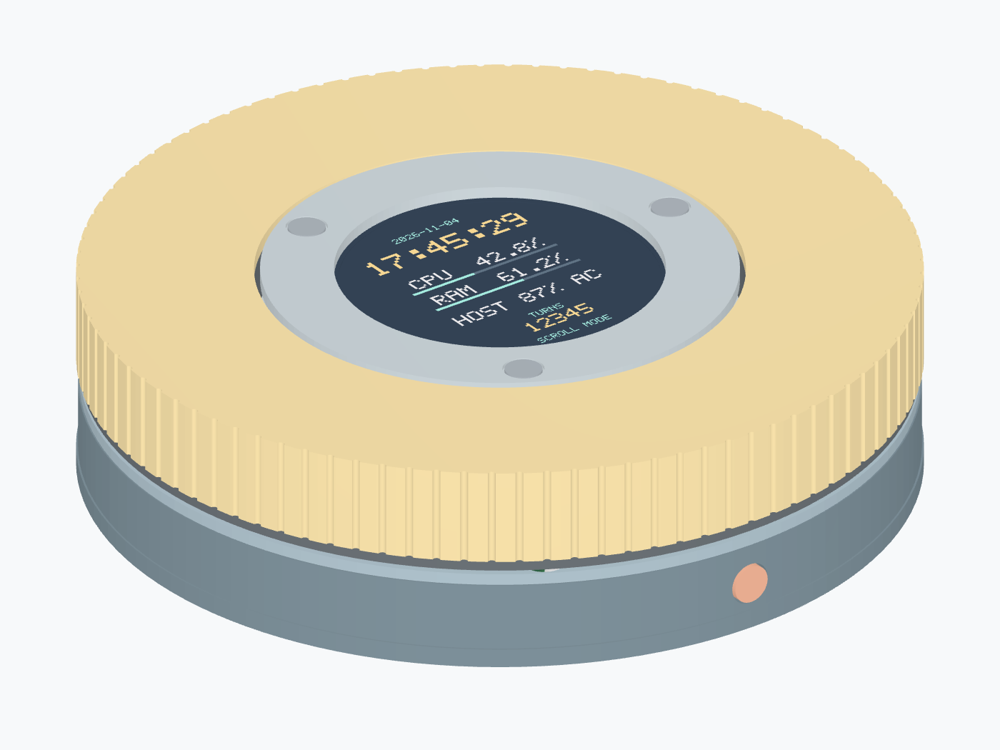

# Assembly / Rev E2

The nominal product is **Ø84.8×22.3 mm** before feet. The fixed screen sits inside the bearing's bore; the cable and screen connector occupy the main PCB's routed central window. All main-board components mount on top. The grip begins at z10.8 mm, with the USB-C port and front mode button below it.

[Assembled model](mechanical/cad/assembled.glb), [exploded model](mechanical/cad/exploded.glb), [height budget and design research](mechanical/LOW_PROFILE.md), [CAD rebuilding](mechanical/README.md).

## Additional hardware

| Qty | Part |
|---|---|
| 1 | Waveshare **19192** non-touch 1.28-inch GC9A01 module; custom H1 JST PH8-to-PH8 cable below |
| 1 | **6712ZZ**, 60 mm ID ×75 mm OD ×7 mm shielded bearing; verify actual race contact widths |
| 1 | PHR-6 programming cable with appropriate JST SPH crimp contacts, terminated for the SWD probe |
| 11 | DIN 965 M2×6 countersunk screws: two chassis, three bearing inner clamp, three outer retainer, three screen bezel |
| 3 | DIN 965 M2×10 countersunk screws for the screen cradle/base posts |
| 1 | Thin transfer-adhesive annulus, 0.05–0.06 mm; 3M 467MP or verified equivalent |
| — | Thin insulating film, LCD edge padding and removable feet |

J4 **B6B-PH**, J6 **S8B-PH**, Omron **B3U-3000P** and the optical sensor are in the electronic BOM. Rev B's smaller bearing, PCB, base and retainer set are incompatible with these mechanics.

## Print preparation

Print all nine product parts from [mechanical/stl](mechanical/stl): `base`, `lid`, `knob`, `outer-retainer`, `bearing-clamp`, `encoder-skirt`, `inner-retainer` (screen cradle), `screen-bezel`, `button-plunger`. Print the fit coupon before the full set. Start with PETG, 0.2 mm layers and four or more perimeters; tune bearing seats against actual parts. The grip, lower retainer and optical skirt are exported inverted in print orientation. Remove any supports from the bearing seats and optical apertures. Prepare the nominal Ø1.6 mm pilot holes for M2×0.4 threads with a suitable tap; check actual printed diameter first. Leave the Ø2.2 mm clearance holes unthreaded.

Use filament tested opaque at **950 nm** for `encoder-skirt`. Visible black colour alone is insufficient. Its 48 slots are about 1.64 mm wide, with a 1 mm radial track. Clean strings without changing individual slot widths. The skirt's upper bonding annulus must be flat; test the chosen adhesive on the actual printed plastics and allow the specified cure/dwell time. The optical skirt is light and does not retain the bearing.

## Board assembly and first power

1. Reflow all SMT components on the top side. Inspect U4 load-switch pin 1 and the common-collector optical sensor orientation against the [datasheet contracts](reference/DATASHEETS.md).
2. Install all through-hole components from above. J6 is a **side-entry** PH header facing into the PCB window; J4 is top-entry. Trim and deburr **all** through-hole tails to ≤0.8 mm. Inspect the solder wells and add thin insulating film so no sharp metal can contact the base.
3. Power by USB and flash the included firmware 5.0.0 using J4. Physical pin order is **3V3 VREF, SWDIO, SWCLK, NRST, GND, BOOT0**; VREF is probe sense, not power input. [Firmware instructions](firmware/README.md).
4. Verify each cable with a continuity meter before mating. On J4, pin 1 is **(−5,20.5)**. On J6, pin 1 is **(−19.5,−10.5)**, continuing in 2 mm steps toward +Y.

| J6 pin | Screen signal | MCU / supply |
|---|---|---|
| 1 | BL | PB11 |
| 2 | RST | PB10 |
| 3 | DC | PB14 |
| 4 | CS | PA8 |
| 5 | CLK | PB13 through R27 |
| 6 | DIN | PB15 through R28 |
| 7 | GND | Ground |
| 8 | VCC | U4 switched 3.3 V |

Use physical pin-1 marks, not wire colour or a guessed viewing direction. The screen uses 3.3 V input and logic.

## Mechanical assembly

1. Make H1 with 2×PHR-8 housings, 16×SPH-004T-P0.5S contacts and eight Alpha 2840/7 32AWG wires, 24.5±0.5 mm free wire between housing backs. Follow the [physical wiring drawing](manufacturing/WIRING.md); verify all eight signal-to-signal continuities. There is no internal battery.
2. Put the PCB over the four Ø2.5 mm locating pegs. The component side faces up. Check every solder tail against its individual floor well. Before seating the PCB, insert the front horizontal `button-plunger` from inside the base: feed its head through the front aperture and lower the stem/flange into the open guide. Seat the PCB, then check the thin nose aligns with SW1 at (0,−31.5).
3. Connect J6's cable and keep it inside the optical track. Install the fixed chassis (`lid`) and its two DIN 965 M2×6 countersunk screws. Its four pads capture the PCB at the NPTH positions. The lid keeper captures the front plunger. Confirm the USB opening and button guide are clear. Measure the released tip gap and actual switch pretravel; tune the plunger/stop before use, avoiding preload or excessive travel. Chassis pilot holes provide 4.8 mm nominal screw engagement.
4. Place the lower outer-race retainer on the chassis, below the future bearing. Keep its three screw holes aligned with the underside Ø4.4 mm driver windows. Fit the bearing over the 59.85 mm stationary post. Fasten `bearing-clamp` with three DIN 965 M2×6 countersunk screws; it contacts the inner race only. Check clearance to the shields and outer race.
5. Bond the opaque `encoder-skirt` concentrically under the grip's central web, using its upper annulus and a 0.05–0.06 mm adhesive layer. Keep tape and adhesive out of the track slots. Lower the grip/skirt over the bearing, carefully guiding the skirt between the sensor arms. The skirt and fixed screen supports must not touch at any angle.
6. Park the rotor so all three lower-retainer holes align with the chassis/base Ø4.4 mm driver windows. Insert the three DIN 965 M2×6 countersunk screws **upwards** through those windows into the grip. The upper shoulder and lower retainer capture the outer race. Do not preload the shield or clamp both races together.
7. Fit `inner-retainer`, the screen cradle, onto the three independent base posts. Fasten with DIN 965 M2×10 countersunk screws. These posts rise inside the PCB window and optical skirt; they never cross a rotating radial web.
8. Connect the screen and route its cable inside the skirt, with no loose loop in the moving track. Orient the screen's connector tab toward **−X (left)**. Seat only the carrier PCB's edges on the cradle. The official module STEP sets the rear connector at +X and the front at Z=20.9 mm. Seat both PHR-8 plugs fully and follow the eight modelled static wire bends; keep the cable entirely inside the optical skirt. Unplug the short harness before lifting the display for service.
9. Fit the fixed screen bezel using three DIN 965 M2×6 countersunk screws. Tighten gently without bowing the module or loading the active glass. The bezel/grip radial gap is 0.6 mm. A 0.2 mm underside relief keeps the lip clear of the front glass; retain the carrier without tightening against the active area. Rotate through full turns and verify freedom before adding removable feet over the Ø4.4 mm driver windows.
10. Initialize FRAM once with USB `RESET CONFIRM`. Check ten turns in either direction, partial reversal, Count-only mode, scrolling, both USB-C orientations and power-cut retention using [BRINGUP.md](validation/BRINGUP.md).

The rear USB-C receptacle sits at the side wall on an integral PCB tab. Its metal face is 0.15 mm beyond the wall (0.05 mm behind the wider base-floor edge). The 22 mm opening and approach gauge allow the specified L-com CAU4CC-40M-1M plug’s nominal **12.9×6.4 mm** section plus its general ±0.5 mm dimensional tolerance. The PCB ends 1.25 mm behind the socket face, clearing the plastic plug body. Check the actual chosen cable and undimensioned mating details. Do not force a larger plug under the rotor. The screen and wires remain stationary. The front button is accessible below the rotating ring: a short press selects Scroll / Count-only, a three-second hold clears the retained count. The screen shows hold progress and confirmation. This clears FRAM count, not the MCU. J4 retains NRST/BOOT0 for programming and remains beneath the removable screen.

The CAD validates nominal solid intersections and a full swept optical ring. It does not establish printed fit, bearing drag, adhesive reliability, cable flexibility, optical contrast, or USB behaviour on real hardware.

Rev E2 uses the official screen STEP, nominal package models, matching bezel pillars and the new USB-only board/firmware together. The LCD carrier/support collision found with the real tab geometry was removed by moving the three bezel-pillar axes to angles 0°,120°,240° at radius 21.1 mm. Full 3D source provenance and remaining model simplifications are in [mechanical/vendor/README.md](mechanical/vendor/README.md).

The nominal front plunger has a 0.10 mm released gap and 0.40 mm stop travel, giving 0.30 mm switch travel. Omron specifies 0.10–0.40 mm pretravel, so these nominal dimensions are not tolerance-qualified. Measure the actual switch and print; adjust the nose/stop in `mechanical/parameters.json` and `generate.py` before extended operation. The 0.6 mm tip requires a careful print and inspection; use supports where necessary.

Rev E2 uses chassis screw axes (±27.6,±27.6) mm and its matching, shorter front plunger. Use the complete E2 print set with the extended E2 PCB. The USB tab and housing overhang are intentional; the original connector lands, slots and locator drills are retained.
