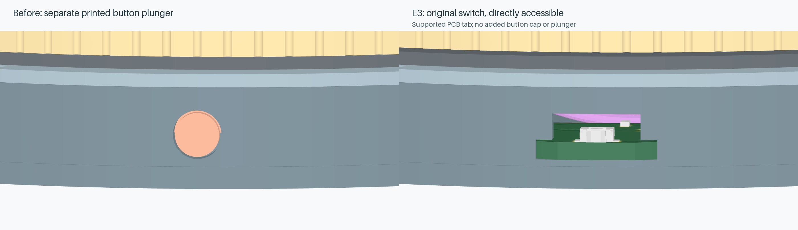

# Desk fidget counter / laptop dashboard

A **USB-powered** scroll ring with a fixed 1.28-inch colour display. The screen shows the laptop's **clock, CPU/RAM usage and battery**, alongside retained full turns and scroll status. A **front side button**, opposite USB-C, switches Scroll / Count-only modes; a three-second hold clears the retained count. Counting continues with scrolling disabled while the computer is awake. There is no internal battery or charging circuit.

**v5.2.1 / PCB Rev E3**: [GitHub release](https://github.com/rushabhcodes/desk-fidget-counter/releases/tag/v5.2.1) · [tscircuit project](https://tscircuit.com/rushabhcodes/desk-fidget-counter#3d) · [complete project ZIP](https://github.com/rushabhcodes/desk-fidget-counter/releases/download/v5.2.1/desk-knob-v5.2.1.zip) · [Gerber ZIP](https://github.com/rushabhcodes/desk-fidget-counter/releases/download/v5.2.1/desk-knob-reve3-gerbers.zip).


This is a **software-checked prototype design**. Physical optical counting, USB electrical behaviour/suspend current, macOS/Windows interoperability, crimp quality and printed tolerances still require a first prototype. Fabrication outputs are supplied for that prototype; they are not evidence of a physically tested product. See [validation and remaining bring-up](https://github.com/rushabhcodes/desk-fidget-counter/blob/v5.2.1/validation/REPORT.md).

| Function | Implementation |
|---|---|
| Display | Waveshare **19192**, non-touch GC9A01, 240×240, active Ø32.4 mm |
| Laptop information | Local USB companion for macOS, Windows and Linux; clock/date, overall CPU%, RAM%, laptop battery%/AC |
| Rotation | 48-slot optical skirt; Vishay TCUT1600X01_A dual sensor, Schmitt conditioning, TIM3 quadrature; 192 edges/turn |
| Counting | Unsigned 64-bit completed turns; either direction adds one; partial reversal cancels |
| Scrolling | Standard USB HID wheel, 32 wheel units/turn, enabled by a short press of the Omron B3U-3000P front button |
| Persistence | MB85RC256V FRAM with two CRC-protected journal slots and read-back verification |
| USB controller | STM32F072CBT6, 48MHz HSI48/CRS; composite HID + CDC |
| Power | USB-C 5V → TLV75533 3.3V; TPS22919 gates LCD/IR power during USB suspend; 100mA bus-powered configuration |
| Connectors | USB-C at the rear shell wall, top JST-PH6 SWD, labelled display-cable solder pads; optional 2.54 mm header DNP |
| Mechanics | **Ø84.8×22.3 mm**, Ø84.8 rotating ring, fixed Ø48 bezel, 6712ZZ 60×75×7 mm bearing |

The **two-layer, 1.6 mm PCB** is routed entirely by tscircuit’s native autorouter. All **38 populated PCB components assemble from the top**; the optional J6 header is DNP. The board has a clipped circular body, integral rear USB and front button tabs (68×83.2 mm total) and a 34.6×40.6 mm rounded window for the static cable and rear display connector. The screen model now comes from **Waveshare's actual STEP file**; package models, the original display PH plug and eight individual wires are included. [Model sources and exact detail limits](https://github.com/rushabhcodes/desk-fidget-counter/blob/v5.2.1/mechanical/vendor/README.md). Removing the cell frees cable space; the bearing and side port still set the 22.3 mm height.

## What to buy or supply for one prototype

| Qty | Item | Exact selection / assembly requirement |
|---|---|---|
| 1 | Main PCB and its **38 populated components** | Two layers, 1.6 mm; order from [manufacturing outputs](manufacturing/README.md). [BOM.csv](manufacturing/BOM.csv) lists every reference, quantity and MPN; [pick-and-place](manufacturing/pick-and-place.csv) is all top side. **J6 is DNP: do not buy or install its optional header for this build.** |
| 1 kit | Display with its supplied cable | [Waveshare **19192**, non-touch 1.28-inch LCD Module](https://www.waveshare.com/product/1.28inch-lcd-module.htm). Kit includes one PH2.0 8-pin, 20 cm lead. Retain the display plug; trial-route, shorten and solder the board ends at J6. **No separate display cable, adapter, housing or crimp contacts.** |
| 1 | Shielded bearing | [Maysme **6712ZZ**](https://maysmeprecision.com/Show/?Cid=677), **60×75×7 mm**, chrome steel with two metal shields. Boundary dimensions are confirmed; actual race-face fit and seller availability are unverified. See [bearing acceptance and fit coupons](mechanical/FIT.md). |
| 11 | Countersunk screws | **DIN 965 M2×6**, nominal Ø3.8 mm head / 1.2 mm head height: 2 chassis, 3 inner-race clamp, 3 outer-race retainer, 3 screen bezel. Check purchased head and drive dimensions. |
| 3 | Longer countersunk screws | **DIN 965 M2×10**, same head; attach the screen cradle to the three base posts. |
| 1 small piece | Optical-skirt transfer adhesive | [**3M 467MP**, 0.05 mm without liner](https://www.3m.com/3M/en_US/p/dc/v000185218/). Cut one annulus, nominal **Ø51.8 mm OD / Ø49.2 mm ID**, keep slots clear. Verify bond to the actual print. |
| As needed | Solder-well insulation | [**3M 5413** polyimide tape, 0.069 mm total](https://www.3m.co.uk/3M/en_GB/p/d/v000091659/). Cover inspected solder wells without obstructing posts or openings; use one layer. It does not make sharp/untrimmed leads acceptable. |
| 8 prints | Enclosure and rotor parts | `base`, `lid`, `knob`, `outer-retainer`, `bearing-clamp`, `encoder-skirt`, `inner-retainer`, `screen-bezel` from [mechanical/stl](mechanical/stl). PETG starting settings: 0.2 mm layers, ≥4 perimeters; print coupons first. |
| Print stock | PETG filament | Enough for the eight parts, coupons and process waste; actual amount depends on slicer infill/supports. The optical skirt needs material **tested opaque at 950 nm**; black colour alone is insufficient. No foam spacer or threaded inserts are part of this design. |
| 1, reuse if suitable | Computer USB data cable | USB-C at the device. [L-com **CAU4CC-40M-1M** drawing](https://www.l-com.cn/Images/Downloadables/2D/CAU4CC-40M-1M_2D.pdf) supplies the current plug gauge, nominal 12.9×6.4 mm plus drawing tolerance. USB 2.0 data is sufficient electrically; a different cable needs its plug checked against the enclosure. |
| Optional | Removable feet / service-window covers | Cut three **Ø5×1 mm** discs from removable adhesive silicone sheet, centred on the three underside driver windows. Adds 1 mm height. Keep access possible for servicing; feet are not included in the 22.3 mm CAD height. |

Programming equipment is reusable and removed before closure:

| Qty | Item | Specification |
|---|---|---|
| 1 | SWD programmer | Genuine [ST-LINK/V2](https://www.st.com/en/development-tools/st-link-v2.html) or an STM32-compatible SWD probe with documented SWDIO, SWCLK, NRST, GND and VTref. USB powers the board; VTref is sense only. |
| 1 | J4 service housing | JST **PHR-6**, 2.0 mm PH series; mates with the populated B6B-PH-K-S(LF)(SN) board header. This is for programming, **not an extra display connector**. |
| 5 plus spares | Service-harness contacts | JST **SPH-004T-P0.5S** for VREF/SWDIO/SWCLK/NRST/GND; sixth BOOT0 cavity may stay empty for SWD. Use [JST-qualified](https://www.jst-mfg.com/product/pdf/eng/ePH.pdf) 32–28 AWG wire, insulation Ø0.5–0.9 mm; about five 150 mm lengths. A correctly specified precrimped PH service lead can replace loose contacts/wire. |
| 1 set | Probe-end termination | Match the actual probe. For genuine ST-LINK/V2, follow the 20-pin map in [WIRING.md](manufacturing/WIRING.md); pin-number maps for other probes differ. Buy a compatible service harness or the required socket termination for your probe, rather than assuming the display lead fits J4. |

For hand assembly, supply a suitable soldering/reflow setup, solder/flux, fine wire stripper and flush cutters, multimeter, caliper, an **M2×0.4 tap**, and a matching precision screwdriver whose shaft passes the **Ø4.4 mm** service windows. Loose JST contacts also require a crimp tool appropriate for that exact contact; buying a correctly precrimped service lead avoids that tooling step. A PCB assembler can supply the BOM parts and soldering work. The fit record still needs actual bearing, screen, supplied-cable and print measurements before production signoff; see [FIT.md](mechanical/FIT.md).

## Start using it

Flash firmware 5.0.0 through J4, then initialize a new FRAM deliberately:

```sh
python scripts/count.py --port /dev/ttyACM0 reset --confirm
```

Boot starts in Count-only mode. Short-press the front button to enable scrolling; short-press again to return to counting alone. Hold it for three seconds to clear or initialize the count. Turn counting and scrolling work without the companion; laptop information needs it running:

```sh
python -m pip install -r companion/requirements.txt
python companion/dashboard.py
```

[Companion installation for macOS/Windows/Linux](https://github.com/rushabhcodes/desk-fidget-counter/blob/v5.2.1/companion/README.md). `HOST OFFLINE` replaces stale laptop metrics after five seconds. Laptop battery values come from the computer; desktop machines show `NO HOST BATTERY`. USB suspend blanks the display and powers the optical emitter down, so turns during suspend are not measured. Completed journal records survive unplugging; an update interrupted during its brief write may roll back to the previous committed record.

The screen and wires stay fixed; the grip rotates around them without slip rings. The ring has no mechanical detents. Use an optical skirt proven opaque at 950 nm.

## Build files

- [Assembly guide](https://github.com/rushabhcodes/desk-fidget-counter/blob/v5.2.1/ASSEMBLY.md), [physical wiring and JST pin views](https://github.com/rushabhcodes/desk-fidget-counter/blob/v5.2.1/manufacturing/WIRING.md).
- [3D CAD and printing](https://github.com/rushabhcodes/desk-fidget-counter/blob/v5.2.1/mechanical/README.md), [assembled GLB](https://github.com/rushabhcodes/desk-fidget-counter/releases/download/v5.2.1/assembled.glb), [exploded GLB](https://github.com/rushabhcodes/desk-fidget-counter/releases/download/v5.2.1/exploded.glb).
- [Manufacturing outputs](https://github.com/rushabhcodes/desk-fidget-counter/blob/v5.2.1/manufacturing/README.md): checked KiCad board, Gerbers, BOM and pick-and-place.
- [Firmware, programming and USB protocol](https://github.com/rushabhcodes/desk-fidget-counter/blob/v5.2.1/firmware/README.md), [component references](https://github.com/rushabhcodes/desk-fidget-counter/blob/v5.2.1/reference/DATASHEETS.md).

```sh
bun install --frozen-lockfile
bun run typecheck && bun run test
bun run check:netlist && bun run check:schematic
bun run build
bun run check:placement && bun validation/check-design.mjs && bun run check:shorts && bun run check:assembly
```

The native Pipeline 9 build generates every trace and via. The electronic audit and unpopulated display header reduce the default population from 45 to 38. The original switch is now pressed directly, without a printed plunger. See [the part-by-part audit](https://github.com/rushabhcodes/desk-fidget-counter/blob/v5.2.1/reference/component-audit.json). See [routing and reproduction](https://github.com/rushabhcodes/desk-fidget-counter/blob/v5.2.1/routing/README.md). Firmware remains version 5.0.0 and enables the button input’s internal pull-up.

The seven schematics have descriptive functional titles and chip-function/rating annotations, following the [tscircuit handbook's design-review guide](https://github.com/tscircuit/handbook/blob/main/guides/preparing-for-design-review.md). `assembly.circuit.tsx` is the published full-product entrypoint; `index.circuit.tsx` is the bare PCB. GitHub is linked to tscircuit and updates synchronize through that integration. Versioned CAD URLs and the release manifest bind viewer models and fabrication outputs to the corresponding release.

Rev E3 PCB and prints belong together; firmware 5.0.0 supports both Rev E, E2 and E3 with unchanged pin assignments. The former toggle board remains under [v4.1.0](https://github.com/rushabhcodes/desk-fidget-counter/releases/tag/v4.1.0). Earlier battery-powered Rev C remains available under [v3.0.0](https://github.com/rushabhcodes/desk-fidget-counter/releases/tag/v3.0.0). Project code is MIT; supplier/package assets retain upstream rights. USB identifiers are TinyUSB development examples; see the firmware guide before distributing a commercial product.

Concepts: [Ploopy Knob](https://ploopy.co/knob/) and [rushabhcodes/fidget-counter](https://tscircuit.com/rushabhcodes/fidget-counter).

The base is reduced from Ø86 to Ø84.8 mm. J1 and its USB protection/CC components move 9 mm outward onto the PCB tab: the real socket face is Y=42.350 mm, 0.15 mm beyond the stationary side wall. A 22 mm access opening and a tolerance-expanded 13.4×6.9 mm plug-body approach gauge clear the PCB, chassis and rotor. The 22.3 mm height is retained. [USB access comparison](https://raw.githubusercontent.com/rushabhcodes/desk-fidget-counter/v5.2.1/mechanical/usb-access-comparison.png).

E3 uses the **cable included with Waveshare 19192**, shortened and soldered at J6 while retaining its original display plug. No custom harness, extra PH housings or crimp contacts are required. J6's optional male header is unpopulated; using the full 20 cm cable instead needs a separate mechanical fit check. [Wiring and trimming instructions](https://github.com/rushabhcodes/desk-fidget-counter/blob/v5.2.1/manufacturing/WIRING.md). Stock cable OD and bend data are unpublished; its drawn envelopes are provisional and must be measured before fabrication/fit signoff.

The direct button actuator projects 0.65 mm beyond the side wall on a supported front PCB tab. There is no separate plunger, keeper or printed cap. Body diameter and height stay 84.8×22.3 mm; the exposed actuator makes total depth approximately 85.25 mm.


