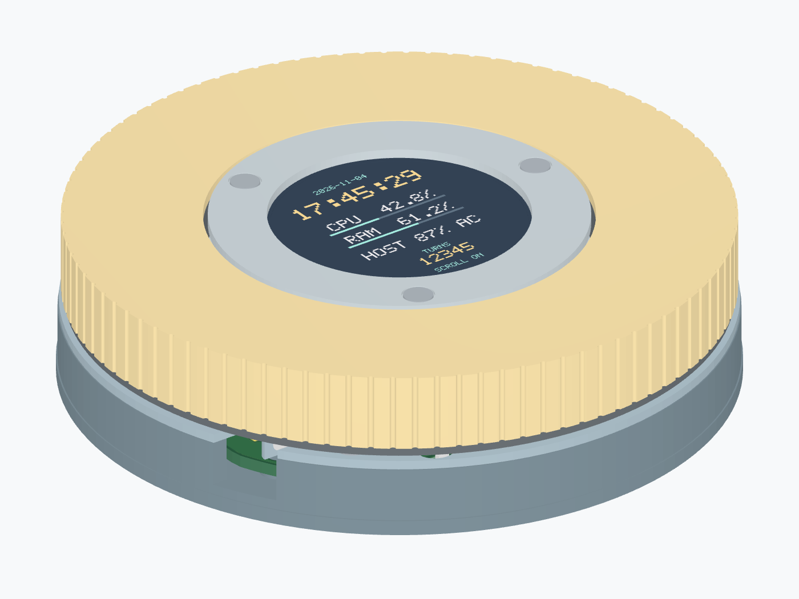
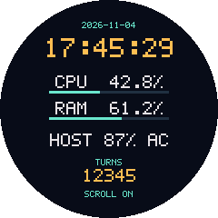

# Desk fidget counter / laptop dashboard

A **USB-powered** scroll ring with a fixed 1.28-inch colour display. The screen shows the laptop's **clock, CPU/RAM usage and battery**, alongside retained full turns and scroll status. The **left toggle** enables USB scrolling; counting continues with scrolling disabled while the computer is awake. There is no internal battery or charging circuit.

**v4.1.0 / PCB Rev D**: [GitHub release](https://github.com/rushabhcodes/desk-fidget-counter/releases/tag/v4.1.0) · [tscircuit project](https://tscircuit.com/rushabhcodes/desk-fidget-counter#3d) · [complete project ZIP](https://github.com/rushabhcodes/desk-fidget-counter/releases/download/v4.1.0/desk-knob-v4.1.0.zip) · [Gerber ZIP](https://github.com/rushabhcodes/desk-fidget-counter/releases/download/v4.1.0/desk-knob-revd-gerbers.zip).





This is a **software-checked prototype design**. Physical optical counting, USB electrical behaviour/suspend current, macOS/Windows interoperability, crimp quality and printed tolerances still require a first prototype. Fabrication outputs are supplied for that prototype; they are not evidence of a physically tested product. See [validation and remaining bring-up](https://github.com/rushabhcodes/desk-fidget-counter/blob/v4.1.0/validation/REPORT.md).

| Function | Implementation |
|---|---|
| Display | Waveshare **19192**, non-touch GC9A01, 240×240, active Ø32.4 mm |
| Laptop information | Local USB companion for macOS, Windows and Linux; clock/date, overall CPU%, RAM%, laptop battery%/AC |
| Rotation | 48-slot optical skirt; Vishay TCUT1600X01_A dual sensor, Schmitt conditioning, TIM3 quadrature; 192 edges/turn |
| Counting | Unsigned 64-bit completed turns; either direction adds one; partial reversal cancels |
| Scrolling | Standard USB HID wheel, 32 wheel units/turn, gated by left NKK G12AH toggle |
| Persistence | MB85RC256V FRAM with two CRC-protected journal slots and read-back verification |
| USB controller | STM32F072CBT6, 48MHz HSI48/CRS; composite HID + CDC |
| Power | USB-C 5V → TLV75533 3.3V; TPS22919 gates LCD/IR power during USB suspend; 100mA bus-powered configuration |
| Connectors | Side USB-C, top JST-PH6 SWD, top-mounted side-entry JST-PH8 display |
| Mechanics | **Ø86×22.3 mm**, Ø84.8 rotating ring, fixed Ø48 bezel, 6712ZZ 60×75×7 mm bearing |

The **two-layer, 1.6 mm PCB** is routed entirely by tscircuit’s native autorouter. All **45 PCB components assemble from the top**. The board has a custom clipped circular outline and a 34.6×40.6 mm rounded window for the static cable and rear display connector. The screen model now comes from **Waveshare's actual STEP file**; package models, keyed JST mates and eight individual wires are included. [Model sources and exact detail limits](https://github.com/rushabhcodes/desk-fidget-counter/blob/v4.1.0/mechanical/vendor/README.md). Removing the cell frees cable space; the bearing and side port still set the 22.3 mm height.

## Start using it

Flash Rev D firmware through J4, then initialize a new FRAM deliberately:

```sh
python scripts/count.py --port /dev/ttyACM0 reset --confirm
```

Turn on the left toggle to scroll. Turn counting and scrolling work without the companion; laptop information needs it running:

```sh
python -m pip install -r companion/requirements.txt
python companion/dashboard.py
```

[Companion installation for macOS/Windows/Linux](https://github.com/rushabhcodes/desk-fidget-counter/blob/v4.1.0/companion/README.md). `HOST OFFLINE` replaces stale laptop metrics after five seconds. Laptop battery values come from the computer; desktop machines show `NO HOST BATTERY`. USB suspend blanks the display and powers the optical emitter down, so turns during suspend are not measured. Completed journal records survive unplugging; an update interrupted during its brief write may roll back to the previous committed record.

The screen and wires stay fixed; the grip rotates around them without slip rings. The ring has no mechanical detents. Use an optical skirt proven opaque at 950 nm.

## Build files

- [Assembly guide](https://github.com/rushabhcodes/desk-fidget-counter/blob/v4.1.0/ASSEMBLY.md), [physical wiring and JST pin views](https://github.com/rushabhcodes/desk-fidget-counter/blob/v4.1.0/manufacturing/WIRING.md).
- [3D CAD and printing](https://github.com/rushabhcodes/desk-fidget-counter/blob/v4.1.0/mechanical/README.md), [assembled GLB](https://github.com/rushabhcodes/desk-fidget-counter/releases/download/v4.1.0/assembled.glb), [exploded GLB](https://github.com/rushabhcodes/desk-fidget-counter/releases/download/v4.1.0/exploded.glb).
- [Manufacturing outputs](https://github.com/rushabhcodes/desk-fidget-counter/blob/v4.1.0/manufacturing/README.md): checked KiCad board, Gerbers, BOM and pick-and-place.
- [Firmware, programming and USB protocol](https://github.com/rushabhcodes/desk-fidget-counter/blob/v4.1.0/firmware/README.md), [component references](https://github.com/rushabhcodes/desk-fidget-counter/blob/v4.1.0/reference/DATASHEETS.md).

```sh
bun install --frozen-lockfile
bun run typecheck && bun run test
bun run check:netlist && bun run check:schematic
bun run build
bun run check:placement && bun validation/check-design.mjs && bun run check:shorts && bun run check:assembly
```

The native Pipeline 9 build generates every trace and via. R29 adds a 1 Ω / 100 nF local backup-domain supply filter; there is no battery. See [routing and reproduction](https://github.com/rushabhcodes/desk-fidget-counter/blob/v4.1.0/routing/README.md). Firmware remains version 4.0.0.

The seven schematics have descriptive functional titles and chip-function/rating annotations, following the [tscircuit handbook's design-review guide](https://github.com/tscircuit/handbook/blob/main/guides/preparing-for-design-review.md). `assembly.circuit.tsx` is the published full-product entrypoint; `index.circuit.tsx` is the bare PCB. GitHub is linked to tscircuit and updates synchronize through that integration. Versioned CAD URLs and the release manifest bind viewer models and fabrication outputs to the corresponding release.

Rev D hardware, mechanics and firmware belong together. Earlier battery-powered Rev C remains available under [v3.0.0](https://github.com/rushabhcodes/desk-fidget-counter/releases/tag/v3.0.0). Project code is MIT; supplier/package assets retain upstream rights. USB identifiers are TinyUSB development examples; see the firmware guide before distributing a commercial product.

Concepts: [Ploopy Knob](https://ploopy.co/knob/) and [rushabhcodes/fidget-counter](https://tscircuit.com/rushabhcodes/fidget-counter).
