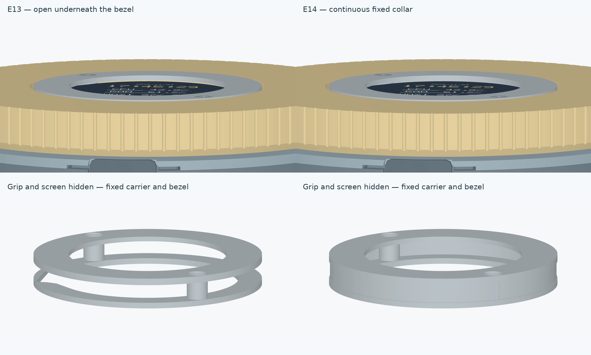
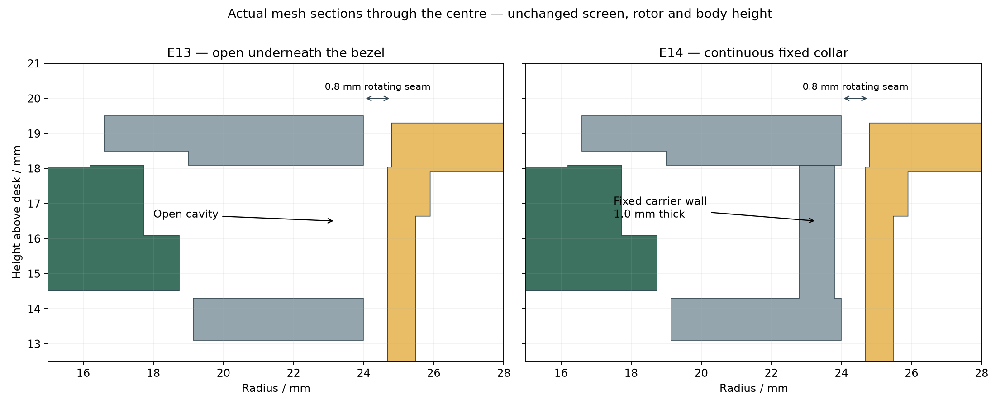

# E14 display gap and whole-design review

The centre screen is stationary and the gold grip rotates around it. Their **0.8 mm radial seam** is required for rotation and the stated print/bearing alignment budget. The current CAD places the bezel top at **Z19.5 mm** and the grip top at **Z19.3 mm**, a **0.2 mm height step**. The much larger vertical separation in the supplied screenshot was not reproduced in the current native assembly or the published v6.0.1 assembly. The uploaded bezel and grip OBJ files match those datums. The exact screenshot version/view is needed to attribute that larger separation.

E13 does leave a real cavity beneath the bezel between two mounting bosses. Collision checks allow that opening. E14 improves this underside by adding a continuous fixed wall; it does not alter the relative height of the screen and grip or make the rotating parts touch.

[Current published v6.0.1 at a low viewing angle](review/current-v6.0.1.jpg). The published bezel and grip OBJ bytes were compared with the E13 local model; their top planes match the dimensions above.

E14 adds a **continuous stationary collar to the existing screen carrier**: 47.6 mm outer diameter, 45.6 mm inner diameter and 1.0 mm wall. It rises from the carrier's flat base to the bezel underside, so it can print directly from the bed. The two existing screws and bosses are retained, and the display still rests on its four supported rear bosses. Nothing presses against the glass. Body size remains **Ø89.4×19.5 mm**, with **six prints and four screws**. PCB F1, firmware, bearing, optical track, screen position, harness and the recessed circular button are unchanged.





The collar masks the cavity; it is not a sealed enclosure. The rotating seam remains open. Narrowing that seam to make the parts touch would consume the running-clearance budget.

## Whole-design findings

| Area | Review and resulting decision |
|---|---|
| Screen / bezel | Added the fixed collar to cover the exposed underside. The active display, glass relief, four module seats, shared screw bores and driver access are retained. |
| Rotating grip / bearing | Kept the calibrated 60/75 mm bearing interfaces and lower bevel. Full-turn envelopes cover all rotor angles and the stated alignment errors. Closing the lower running seam would also reduce USB-plug clearance. |
| Circular button | Kept the recessed curved face, captive guides, separate travel stops and foam return. It remains inside the body circle through its full stroke. Printed friction, end presses, return force and life still need a prototype. |
| USB access | Kept the rear approach opening and verified plug envelope. The 0.31 mm remaining vertical margin under the full hardware probe is a reason to retain the lower clearance. |
| PCB / electronics | F1 copper, all 52 fitted packages and the enclosure datums are retained. The collar does not require a board change or new routing. |
| Wiring / service | The collar clears the original display, PH8 plug, SH8 plug and eight wires, including the 43/44/45 mm harness checks. Connect the board end while the centre is open, feed the lead through the carrier and mate the display end before lowering the module. The rigid module/PH8 insertion path is checked at nine heights; actual flexible wire dressing and service access still need a first assembly. |
| Printing / assembly | The collar belongs to the existing flat-printed carrier and adds no support-dependent horizontal roof. All six product meshes must remain connected watertight solids. |
| Size / feel | The body is already arranged around the large hollow bearing, fixed display and optical encoder. Further diameter reduction would require a different bearing and PCB/mechanical layout. Comfort, grip texture, desk slip and bearing drag need a physical sample. |

## Evidence and limits

The refreshed [CAD audit](AUDIT.md) covers exterior, underside, screw access, harness, encoder and internal views. It checks the actual delivered GLB against all six STLs, along with nominal interference and full rotor tolerance envelopes. The new carrier blocks all **144 sampled radial sight lines**, at 48 angles and three heights. The new collar has **0.88 mm nominal optical-track clearance**, leaving **0.26 mm under the conservative 0.62 mm radial print probe**. The original bezel seam retains its 0.38 mm margin in the engineering fit budget.

This is a checked improvement to the packaging. Choosing an overall optimum also requires measured comfort, drag, print quality and assembly effort. The actual bearing, printer compensation, glass stack, cable mating, button force/life, optical response, USB current and electronic operation still need the [first prototype checks](../validation/BRINGUP.md). Existing catalogue models and stated assumptions cannot establish those physical properties.

Reproduce the comparison from the retained E13 assembly and the current model:

```sh
python mechanical/review.py --before /absolute/path/to/E13/assembled.glb
```

The model and image hashes are recorded in [review/report.json](review/report.json); no purchased part is rescaled in the comparison.
