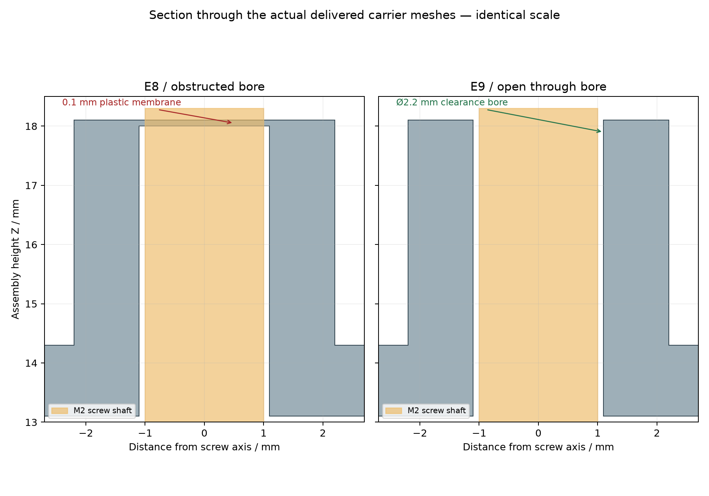
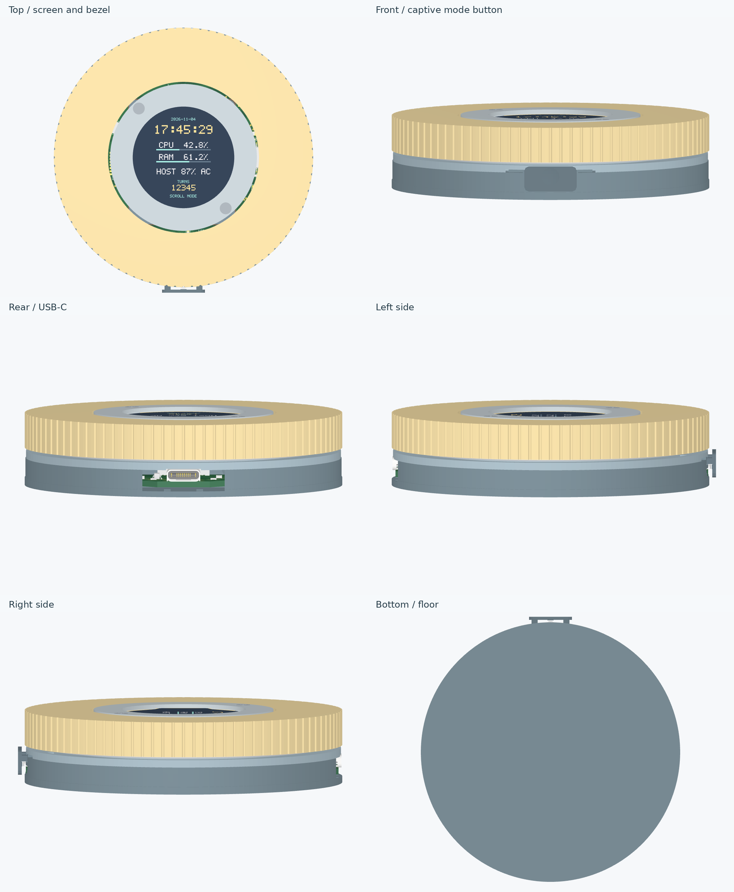
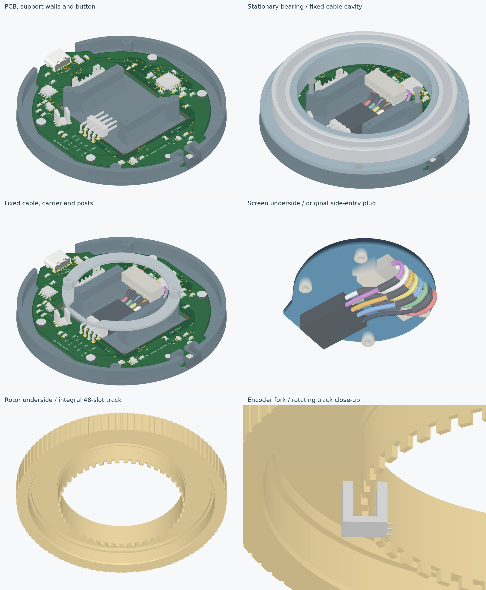
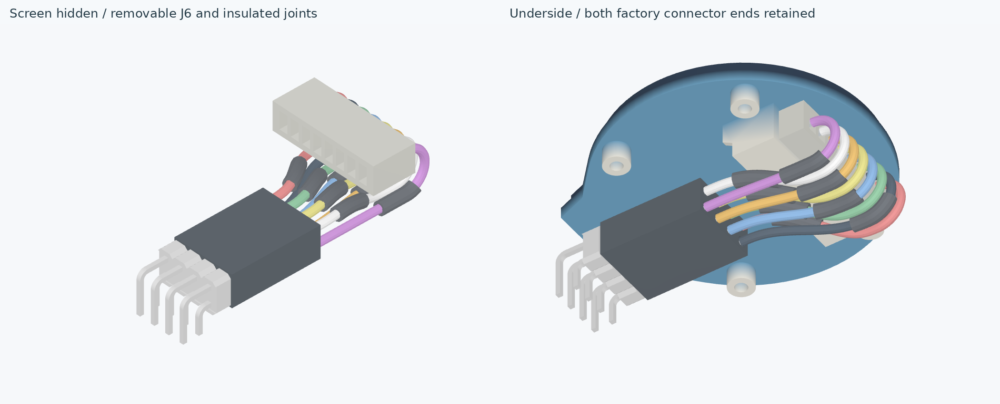

# Visual and geometry audit — E11 / v5.10.1

Audited 9 November 2026 using the delivered `cad/assembled.glb`, the six delivered STLs, the original supplier screen geometry and the checked PCB. The model passes the nominal visual and geometric checks below. Physical fit and strength remain unmeasured.

## Findings corrected

1. **Screen-carrier screw bores were obstructed.** E8 cut each bore from Z13.0 to Z18.0, while its boss reached Z18.1. Each hole therefore had a 0.1 mm plastic membrane. The actual screw meshes intersected the carrier by a combined 0.628 mm³. E9 cuts through the full boss; both Ø2.2 mm clearance bores pass an independent M2 shaft gauge. A 4 mm driver gauge reaches both shared screen screws.
2. **The simplified screen STEP did not protect space for rear electronics.** It includes the PCB, bosses and connector, but omits rear ICs/passives. The previous rim approached the PCB underside to 0.2 mm. E9 clears the supplier PCB's actual non-circular outline, including the tab shoulders, with 0.4 mm lateral allowance. A conservative 2 mm rear-component reservation is checked against all prints and the current Ø0.8 mm wire envelopes. Existing boss, socket and estimated mated-plug footprints are excluded because they already contain checked hardware. This is an engineering allowance, not published supplier component heights.

E11 uses the exact imported JST SM08B-SRSS-TB(LF)(SN)/C160407 SMT header and one H1 crimped SH8-to-PH8 replacement lead. Both keyed housings, contacts and all eight wires are visible. The kit jumper lead is unused. Housing engagement and dressed bends are explicit nominal approximations; actual crimped harness fit remains a prototype check. Body Ø84.8×19.5 mm, six prints, four screws.



## Visual inspection

The six exterior views cover top, bottom, front, rear and both sides. Six internal views expose the PCB/support walls, bearing cavity, fixed cable/carrier, screen underside, rotor underside and encoder fork. These are depth-tested renders of the actual GLB; hidden parts are identified. No purchased part is resized to create clearance.

| Area | Inspection result |
|---|---|
| Screen and bezel | Centred, correct official module pose; active display unobstructed. Four real rear bosses have seats; separate enclosure screw axes avoid the module holes. |
| Grip and bearing | One complete bearing object, 60×75×7 mm boundary; separate inner/outer race contacts. Grip, bearing and screen share their intended centre. |
| Encoder | Integral 48-slot track inside the fork; nominal and tolerance-expanded full-turn sweeps pass. |
| USB | Actual unscaled C2909598 faces the rear opening; 13.4×6.9 mm plug approach clears shell and rotor. |
| Mode button | Captive guides inside the circular shell; only the moving face projects. Nominal travel and finger access pass. |
| Cable | Keyed J6 SH8 plug, PH8 display plug, eight wires and contact/conductor detail. NominalØ0.61mm wires;Ø0.8mm checked at43/44/45mm free lengths. No inline joints. |
| Screws | Four installed screws; two open carrier bores. Designed interference is confined to pilot bores that are tapped before assembly. |
| Export alignment | Six single connected watertight product STLs. Restoring their print poses matches GLB vertices within 0.00002 mm. |







Two additional close views show J6, the single keyed plug at each end of H1 and all eight crimped wires.

The 0.8 mm annular running gap and PCB clearance visible through the port openings are intentional clearances, not displaced parts. [geometry-check.json](geometry-check.json) retains their nominal and stated tolerance checks.

## Checks and reproduction

[audit/report.json](audit/report.json) records **171 solid-pair checks with zero unexpected intersections**. Two allowed contact classes have geometric masks: screw shanks inside tapped pilot regions, and the estimated display plug inside the supplier's simplified solid socket envelope. Overlap outside those masks is rejected. The audit also checks print-to-GLB correspondence, open carrier bores and driver access. `check:assembly` verifies the audited GLB/STL hashes.

Use the CAD Python environment in [vendor/README.md](vendor/README.md):

```sh
python mechanical/generate.py
python mechanical/generate-assembly.py
python mechanical/audit.py --render
bun run build
bun run check:assembly
```

For the historical bore comparison, extract `mechanical/stl/screen-carrier.stl` from Git commit `b649945` into a temporary file and add `--compare-carrier /absolute/path/to/that.stl` to the render command. It is not an additional product print.

## Physical qualification

The supplier STEP omits rear electronics and fine connector details. The replacement H1 lead's seating and installed bend suitability remain nominal. The 2 mm rear-electronics reservation and cable envelopes are explicit engineering allowances; verify the actual screen and made-to-drawing harness before final closure. Bearing retention, PLA fit/creep, button return/overtravel and optical opacity still require [fit checks](FIT.md) and [prototype bring-up](../validation/BRINGUP.md). A visual audit cannot establish those physical properties.
