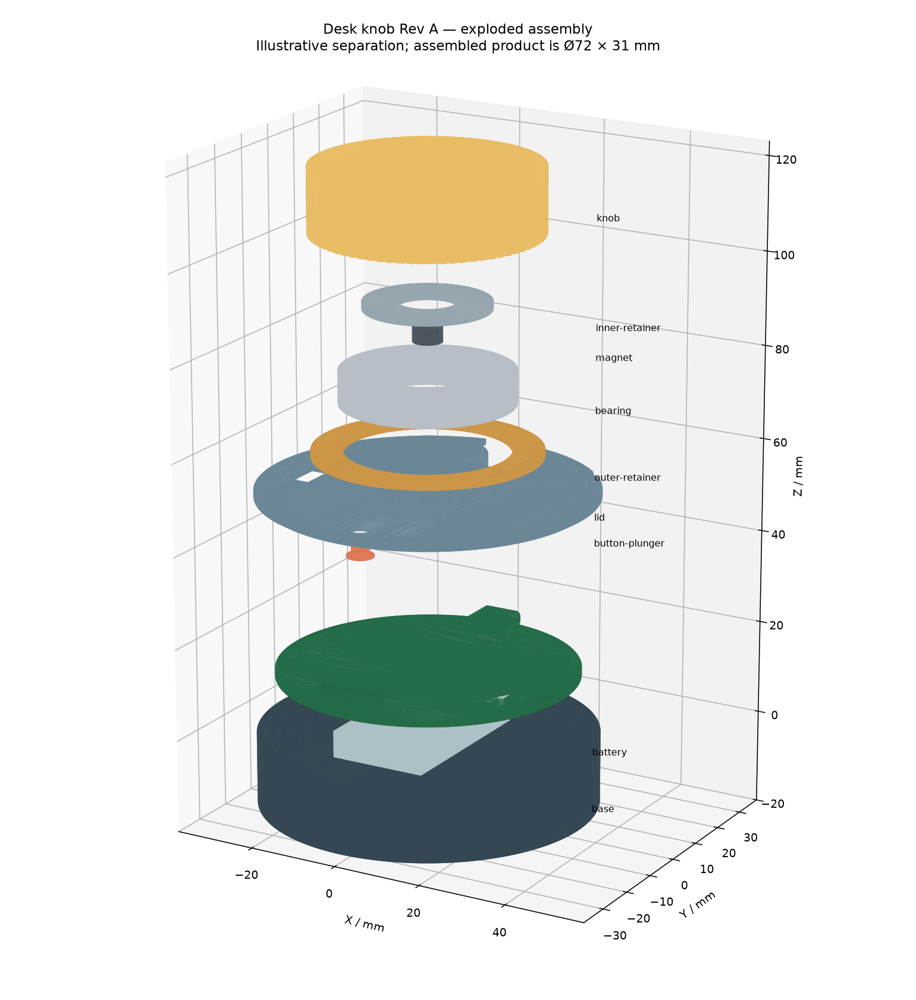

# Assembly CAD / Rev A

The [tscircuit project](https://tscircuit.com/rushabhcodes/desk-fidget-counter) opens the assembled product in its 3D viewer. Its entrypoint is `assembly.circuit.tsx`, which places the original PCB alongside six printed parts, bearing, magnet, protected cell, fasteners and the missing connector/switch/package envelopes. The separate exploded GLB shows the mechanical parts separated around the stationary PCB.

- [Assembled product — GLB](cad/assembled.glb)
- [Exploded assembly — GLB](cad/exploded.glb)
- [Assembly instructions and hardware BOM](../ASSEMBLY.md)
- [Printable STL parts](stl)

Both GLBs contain individually named nodes, so a glTF viewer can select or hide parts. GLB dimensions follow glTF: **metres, +Y up**. The assembled bounding size is **0.072 × 0.031 × 0.072 m**. The individual OBJ models are **millimetres, +Z up**, in the PCB-centred frame; the floor is at z = −10.8 mm and the PCB mid-plane is z = 0. Printable STLs retain their print orientations. Do not import the print-oriented knob STL directly into an assembly without restoring its pose.



The six printed parts reuse the exact released printable meshes. Bearing, magnet, cell, fasteners and added package bodies are dimensioned representations; threads, drive recesses, internal bearing details, pouch cables and NTC wiring are omitted. Existing PCB package models are illustrative. The drawings and physical clearance checks remain defined by the datasheet contracts and assembly guide. Exploded offsets illustrate part relationships; they do not simulate a collision-free disassembly path.

## Rebuild

```sh
bun install --frozen-lockfile
bun run build
bun run cad:pcb
uv run --with manifold3d==3.5.4 --with trimesh==5.2.0 --with matplotlib==3.11.2 mechanical/generate-assembly.py
bun run build
bun run check:assembly
```

`mechanical/generate.py` remains the printable-geometry source. Run it first only when changing printable geometry. `scripts/export-pcb-cad.mjs` exports the actual populated PCB from `dist/index/circuit.json`. The assembly generator restores print poses, adds hardware, checks product dimensions, writes coloured OBJ assets and exports the two self-contained GLBs. Native tscircuit model URLs reference the immutable GitHub release tag; the same assets are included locally for offline inspection.
