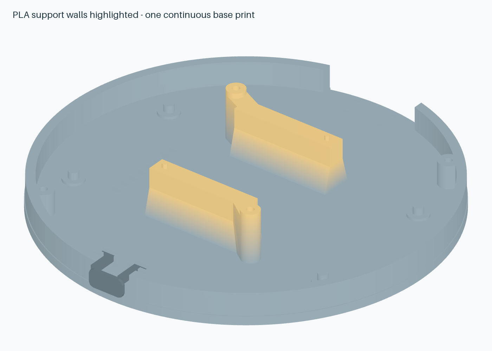

# E7 mechanics / E3 PCB

The enclosure uses **six product prints and four screws** while retaining the Ø84.8×19.5 mm body, fixed Waveshare 19192 display, rear USB-C and a captive front button cap. The optical track is integral to the grip. The complete bearing has one CAD visibility control; both races, shields, balls and cage are included in that object.

| Print | Orientation | Notes |
|---|---|---|
| `base` | Flat floor on bed | PCB locators, two braced screen-support walls and solder wells are integral. |
| `lid` | Supplied orientation | Support the underside annular plate above the six capture feet; avoid supports on bearing fit surfaces. |
| `knob` | Front face on bed | Integral 48-slot optical track; use material tested opaque at 950 nm. |
| `screen-carrier` | Flat annulus on bed | Short bosses share the bezel fasteners; no separate carrier screws. |
| `button-cap` | Fork arms/ears down, supplied inverted pose | Use a brim and local support under the face/boss if bridging needs it; clean the 0.4 mm guide clearances. No extra fasteners. |
| `screen-bezel` | Front face on bed | Use the supplied inverted pose; the glass relief faces upward during printing. |

Start with a 0.4 mm nozzle, 0.2 mm layers and six perimeters and 35–50% infill. Print the nominal fit coupon first with the actual bearing; the tight/loose alternatives help measure printer compensation. These settings are starting points, not a guarantee of fit. See [FIT.md](FIT.md).

Hardware is two DIN 965 M2×6 chassis screws and two M2×10 shared screen screws, one complete 6712ZZ bearing, and six compliant PCB capture pads. There are no separate outer bearing retainer, bearing clamp, optical skirt or encoder adhesive ring. [Assembly sequence](../ASSEMBLY.md) and [off-board shopping table](../README.md#what-to-buy-outside-jlcpcb).

The PCB window is 34.6×40.6 mm, R2, for the fixed cable and the two braced support walls. PCB underside/top remain Z2.6/4.2 mm; carrier rim Z14.3 mm (0.2 mm below the screen PCB), display front Z18.1 mm and bezel top Z19.5 mm. J4 remains at (0,+20.5) mm; disconnect its programming lead before closure. The USB keeps its rear position; the front switch has an 8×4 mm printed cap. The guide walls, travel stops and lid roof sit inside the circular shell; only the moving pusher projects. The circular body remains Ø84.8 mm; the cap brings overall depth to 86.6 mm. The screen is located by two short pins at its real mounting-boss centres (±9.3, ±13.35 mm), with all four rear bosses seated on the 4 mm-thick end walls. The separate enclosure screw axes remain outside those module holes. No purchased part is rescaled.

The supplied display lead mates sideways, parallel to the screen PCB; its original PH plug is retained. Mate it before lowering the screen, then shorten and solder the board ends at J6. The illustrated dressed paths are about 50 mm, plus stripped ends; trial-fit with slack, rather than cutting to a fixed drawing length. Its unpublished wire dimensions remain accepted approximations: Ø1.2 mm rendered and Ø1.5 mm checked. Trial-dress the actual cable before cutting. No additional display connector or cable is purchased.

## Rebuild

With the pinned Bun dependencies and Python packages in [vendor provenance](vendor/README.md):

```sh
bun run build
python mechanical/generate.py
bun run cad:pcb
python mechanical/generate-assembly.py
bun run build
bun run check:assembly
python mechanical/render.py
```

`parameters.json` and the source scripts define all nominal geometry. Prints are restored from their recorded bed poses to assembled positions. `cad/assembled.glb`, `cad/exploded.glb` and the per-part OBJs use the same parts; OBJ is PCB-centred millimetres/+Z-up, glTF is metres/+Y-up. Relative model paths use included files.

Checks retain the complete rotor sweep, actual screen/package models, larger wire envelope, USB/button access and race-specific bearing interfaces. All six product meshes must be connected, watertight solids. Push-fit retention is a physical test; geometry checks cannot certify friction or printer capability. [Detailed limits](vendor/README.md), [fit budget](fit-budget.json), [geometry checks](geometry-check.json) and [bring-up](../validation/BRINGUP.md).



The highlighted walls and webs are part of one base print. All four screen bosses seat at Z12.0 mm; the carrier rim has 0.2 mm relief below the screen PCB so it does not compete with those seats. [Side-entry connector view](screen-connector.png) · [Source-derived screen audit](screen-fit.json). Physical PLA strength and exact kit mating remain prototype checks.
