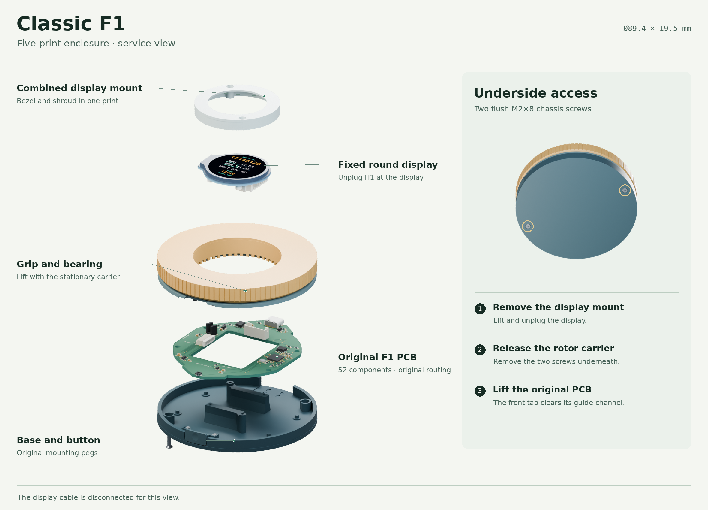

# Classic F1 service enclosure

This five-print prototype fits the original routed Classic F1 PCB. It keeps all 52 fitted components, mounting holes, board outline, USB-C and switch positions, and firmware. The existing 34.6 × 40.6 mm PCB window already accommodates the display supports and H1 cable. The body stays Ø89.4 × 19.5 mm. The original PCB fabrication package and E14 enclosure are available under their existing paths.

[Five STL files](print-files.zip) · [Assembled GLB](cad/assembled.glb) · [Exploded GLB](cad/exploded.glb) · [Exterior comparison](previews/comparison.png) · [CAD checks](checks.json)



| Print | Function and orientation |
| --- | --- |
| Base | Original PCB seats, braced screen supports and front guide, with underside screw clearance and a channel for lifting the PCB. Print floor down. |
| Rotor carrier | Stationary lid with the original bearing post and PCB capture feet. It adds two underside screw pilots and the relocated button stops. Keep support contact off the bearing seat and button guide surfaces. |
| Grip | Original E14 print with the integral 48-slot optical track. Print grip face down. |
| Display mount | One print combines the face bezel and fixed shroud. The four existing supports carry the display. Print bezel face down and inspect the glass relief and both through bores. |
| Button cap | Original E14 curved paddle. Keep the supplied ears-down orientation and the two foam-return stacks. |

The four fasteners are two DIN 965 M2×8 underside screws and two DIN 965 M2×10 display screws. Use the original H1 crimped cable, 6712ZZ bearing, six PCB capture pads and bearing calibration coupon. [E14 fit guide](../FIT.md) · [H1 wiring and parts](../../manufacturing/WIRING.md)

## Assembly and service

1. Check the bearing on the original coupons. Clean the front guides, underside screw recesses, and screen openings. Tap the two upper carrier pilots and the two existing display pilots. Use the E14 instructions for the six capture pads and two return stacks. [E14 assembly instructions](../../ASSEMBLY.md)
2. Set the fitted F1 board on the locator pegs. Install the button between its guides with the return stacks behind the ears. Seat the rotor carrier over the board and fit the two M2×8 screws from the underside. Press the bearing and grip onto their calibrated seats. Check that the button releases and the grip turns freely.
3. Connect H1 and lower the display onto the four rear boss seats. Fit the combined display mount using the two M2×10 screws. The mount bottoms on the screw supports. Keep pressure off the glass and check the full rotating seam. Confirm the grip material is opaque at 950 nm.
4. For service, unplug USB, remove the two upper screws and lift the display mount. Support the display while lifting it enough to disconnect H1, then remove the display. Lift the grip, bearing and carrier together after removing the two underside screws. The front of the populated PCB can now lift past the old guide overhang. Support the loose button as the carrier comes off.

## Rebuild

Run from the project root. The generator uses the checked-in E14 STLs and assembly CAD, along with the built Classic circuit JSON.

```sh
uv run --python 3.12 --with numpy --with scipy --with pillow --with trimesh --with manifold3d==3.5.4 python mechanical/classic-service/generate.py
```

The generator defaults to the included `dist/index/circuit.json`. Run `bun run build` to refresh the circuit JSON after changes to its source. Outputs are in `dist/classic-service/`. The five closed STL meshes use print poses. The assembled and exploded GLBs use metres and a Y-up axis. The exploded model keeps the grip, bearing and carrier together and separates the display and PCB for service. `checks.json` records the tested geometry and the source hashes. [Review log](REVIEW.md)

The CAD checks use the project’s existing fit budget. A physical build still needs a trial of display cable slack, closure and return at the button stops, bearing retention, and the strength of the revised screw bosses.
