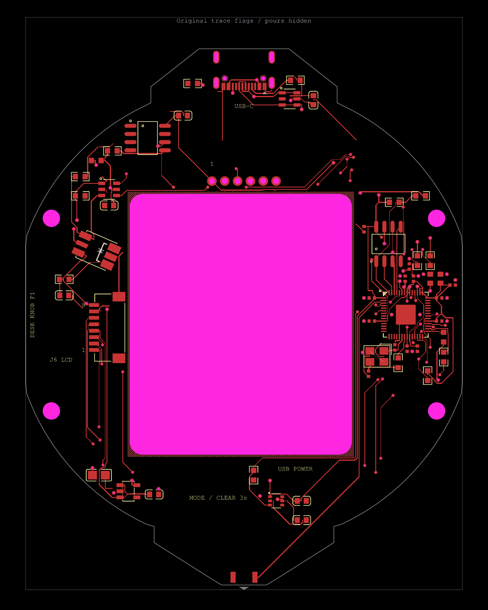
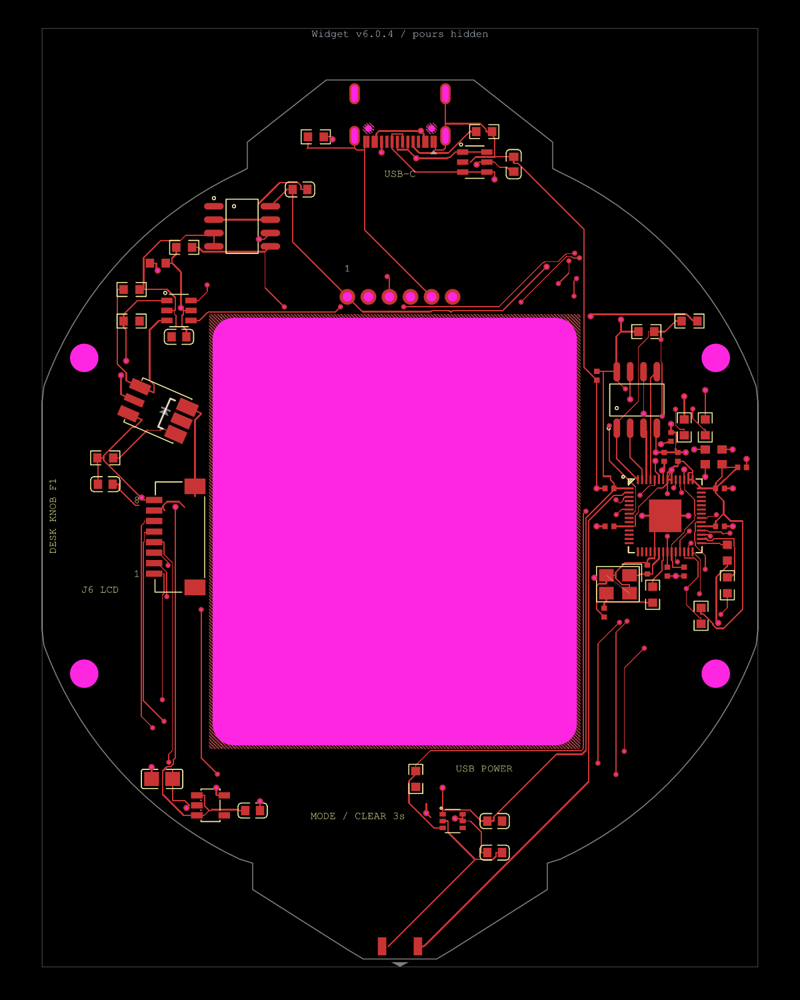

# Ground trace display correction

The apparent open trace in TSCircuit v6.0.3 is continuous in the published circuit data. `pcb_trace_external_235` ends at (17.4804, 27.1958); `pcb_trace_external_236` continues from that exact top-layer point to (17.4804, 14.0995). Both belong to GND. No routing repair is needed for this junction.

Core 0.0.2315 classified the entire 13.0963 mm continuation as inside a copper pour using just five equally spaced samples. All five samples are inside, but the line crosses a 0.500697 mm notch in that pour between Y=24.249652 and Y=24.750348. The renderer skips an entire segment when both endpoints have `is_inside_copper_pour=true`. That false classification hides the continuation, including its exposed part. See the [measured published-data diagnosis](diagnostics/v603-ground-trace-display.json).

Widget v6.0.4 uses tscircuit `0.0.3157` with core `0.0.2340`. The released fix checks the endpoints and every polygon boundary, including hole boundaries. It also checks neighbours saved in separate trace records, which keeps the short connection from C1's upper pad to the diagonal visible. [Upstream fix](https://github.com/tscircuit/core/pull/5353)

Run `bun install --frozen-lockfile` and `bun run test:route-display`. All eight regressions pass against the released core, including the exact published continuation and its pour geometry. The tests run in circuit CI.

The independent full-board check uses complete Shapely polygons rather than the patched implementation:

```sh
python validation/check-pour-visibility.py dist/index/circuit.json validation/trace-visibility-check.json
```

The original board has 11 incorrectly hidden sections out of 136 marked sections. The v6.0.4 board has zero out of 51. The comparison checks all PCB and assembly records and verifies both C1 connections. Core now assigns eight existing USB connector paste apertures to J1. The regenerated paste plots match the fabrication kit at all 220 apertures. KiCad DRC finds zero violations and zero unconnected items. [Comparison report](trace-visibility-check.json)

These images render the actual before/after route data with pour fills hidden, matching the reported viewing condition. Hiding pours is a rendering-only diagnostic; generated circuit JSON and manufacturing geometry are never edited by hand.

| Before | After |
|---|---|
|  |  |
